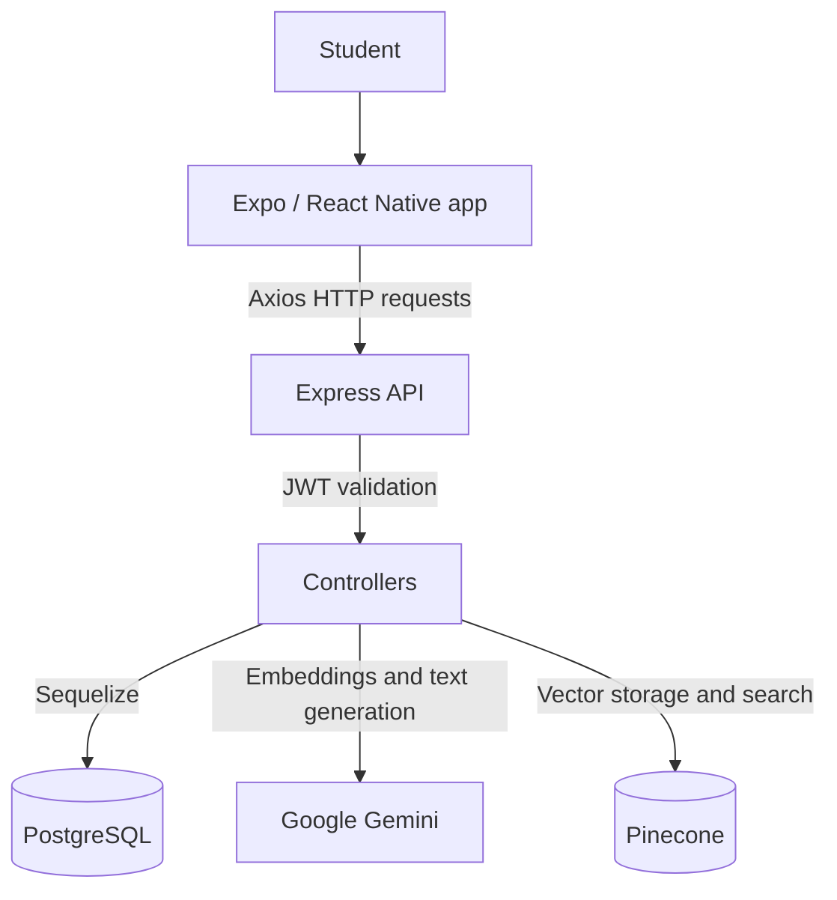
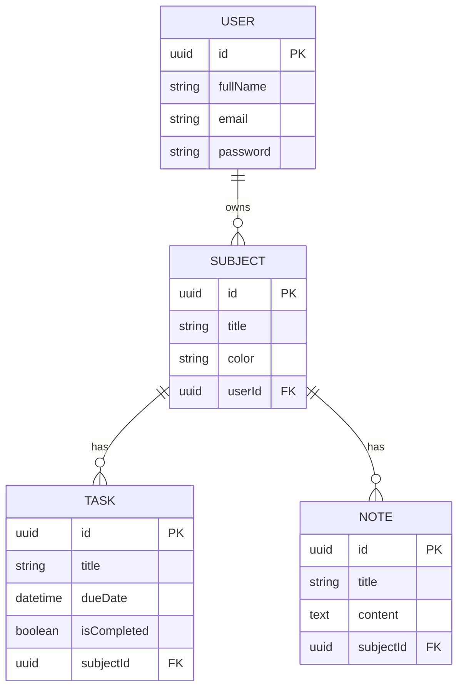
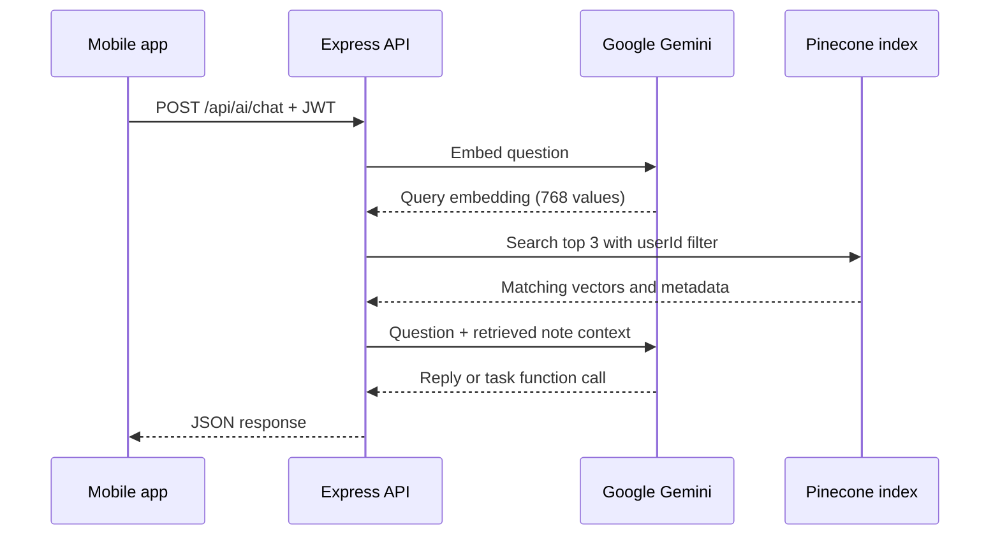

<div align="center">


# StudyBuddy AI

**A smarter way to organize schoolwork and learn from your own notes.**

A full-stack student productivity application with a **React Native / Expo mobile app**, a **Node.js / Express API**, a **PostgreSQL database**, and an experimental **Gemini + Pinecone AI tutor**.


[Features](#features) · [Architecture](#architecture) · [Getting started](#getting-started) · [API](#api-reference) · [Database](#database-model) · [Limitations](#current-limitations)

</div>

---

## Overview

StudyBuddy AI helps students manage subjects, schedule assignments, save notes, and ask an AI tutor questions. The application has two main parts:

- **Mobile:** The screens students interact with. Built with React Native, Expo, and React Navigation.
- **Backend:** The server that checks sign-in details, stores data, and connects to AI services. Built with Express, TypeScript, Sequelize, and PostgreSQL.

The AI workflow is designed to find relevant study material in Pinecone and include it when generating an answer. **This is a prototype, not a production-ready document-processing system.** See [Current limitations](#current-limitations) for the features that are still incomplete.

## Features

| Feature | What it does | Implementation status |
| --- | --- | --- |
| Account registration and login | Creates student accounts and authenticates with JWT | Implemented |
| Secure mobile token storage | Stores the login token with Expo SecureStore | Implemented |
| Subject management | Creates and lists subjects | Implemented |
| Task management | Creates, lists, completes, and deletes tasks | Implemented |
| Notes list | Creates, lists, and deletes text-backed notes | Implemented |
| File picker | Selects a document from the mobile device | UI implemented; actual file extraction is not |
| AI tutor | Sends chat requests to the backend Gemini integration | Implemented in code; depends on compatible model/API configuration |
| Vector-based note search | Generates embeddings and queries a Pinecone index | Implemented in code; has known limitations |
| AI-created study tasks | Uses a Gemini function declaration to create tasks | Implemented in code; needs further input validation |
| Profile update | Updates a student's full name | Implemented |

## Technology stack

| Layer | Main tools |
| --- | --- |
| Mobile application | React Native, Expo, TypeScript, React Navigation |
| HTTP communication | Axios |
| Authentication storage | Expo SecureStore |
| Local profile-image storage | AsyncStorage |
| Backend API | Node.js, Express 5, TypeScript |
| Database and ORM | PostgreSQL, Sequelize 6 |
| Authentication | JSON Web Tokens (JWT), bcryptjs |
| AI generation and embeddings | Google Gen AI SDK |
| Vector storage and similarity search | Pinecone |
| Interactive API documentation | OpenAPI and Scalar |

## Architecture



**Think of it like a school:** the mobile app is the front desk, the backend is the school office, PostgreSQL is the filing cabinet, and the AI services are the digital study assistant.

### Project folder structure

```text
StudyBuddy-AI-main/
├── .gitignore
├── README.md                        # This guide
├── backend.mmd                      # Backend diagram source
├── mobile.mmd                       # Mobile diagram source
├── Backend/
│   ├── class_diagram.mmd            # Database/class diagram source
│   ├── config/
│   │   ├── database.ts              # Sequelize/PostgreSQL connection
│   │   └── pinecone.ts              # Pinecone client and index accessor
│   ├── src/
│   │   ├── controllers/             # Request-handling logic
│   │   │   ├── aiController.ts
│   │   │   ├── login.ts
│   │   │   ├── noteController.ts
│   │   │   ├── signup.ts
│   │   │   ├── subjectController.ts
│   │   │   ├── taskController.ts
│   │   │   └── userController.ts
│   │   ├── docs/openapi.ts          # API specification
│   │   ├── middleware/              # JWT and input validation
│   │   ├── models/                  # User, Subject, Task, Note
│   │   ├── routes/                  # URL-to-controller mappings
│   │   ├── types/                   # Shared server request types
│   │   └── server.ts                # Express entry point
│   ├── create_pinecone_index.ts     # One-time index creation helper
│   ├── scratch*.ts                  # Local experiments / diagnostics
│   ├── package.json
│   └── tsconfig.json
└── Mobile/
    ├── assets/                      # Bundled images and icons
    ├── src/
    │   ├── api/client.ts            # Axios base URL and JWT interceptor
    │   ├── components/              # Reusable form/UI components
    │   ├── context/AuthContext.tsx  # Login state and token persistence
    │   ├── screens/                 # Mobile screens
    │   │   ├── AddTaskScreen.tsx
    │   │   ├── AiChatScreen.tsx
    │   │   ├── HomeScreen.tsx
    │   │   ├── LoginScreen.tsx
    │   │   ├── NotesScreen.tsx
    │   │   ├── ProfileScreen.tsx
    │   │   ├── RegisterScreen.tsx
    │   │   ├── TasksScreen.tsx
    │   │   └── UploadNoteScreen.tsx
    │   ├── types/                   # App-specific TypeScript types
    │   └── ...
    ├── App.tsx                       # Navigation and application root
    ├── index.ts                     # Expo entry point
    ├── app.json                     # Expo settings
    ├── package.json
    └── tsconfig.json
```

Both application folders also contain `package-lock.json` for reproducible dependency installation. Do not commit `.env` files or API secrets.

## Getting started

### Requirements

- Node.js and npm (use a version compatible with the dependencies in each `package.json`).
- A running PostgreSQL server.
- A Google Gemini API key and a Pinecone API key for AI features.
- A Pinecone serverless index compatible with **768-dimensional** embeddings.
- Expo Go or an Android/iOS simulator for the mobile app.
- A computer and phone/emulator that can reach each other over the network.

### 1. Download the project

Clone your own repository, or download the project ZIP and extract it. Then open a terminal inside its root directory (the one containing `Backend/` and `Mobile/`).

### 2. Create a PostgreSQL database

For example, using PostgreSQL's command-line utility:

```bash
createdb -U postgres studybuddy_db
```

You can instead create `studybuddy_db` with pgAdmin or another PostgreSQL client. Make sure the configured database user has permission to create and update tables.

### 3. Configure the backend

```bash
cd Backend
npm ci
```

Create a file named **`Backend/.env`**:

```dotenv
PORT=5000
DB_HOST=localhost
DB_PORT=5432
DB_NAME=studybuddy_db
DB_USER=postgres
DB_PASSWORD=replace_with_your_database_password
JWT_SECRET=replace_with_a_long_random_secret
GEMINI_API_KEY=replace_with_your_gemini_api_key
PINECONE_API_KEY=replace_with_your_pinecone_api_key
PINECONE_INDEX_NAME=studybuddyai
```

> **Important:** The configuration file reads **`PINECONE_INDEX_NAME`**, not `PINECONE_INDEX`. Keep credentials out of Git and never put Gemini or Pinecone keys in the mobile application. The current code falls back to the unsafe JWT secret `secret` if `JWT_SECRET` is missing, so always set a strong value locally.

### 4. Create the Pinecone index

From the `Backend/` directory, run:

```bash
npx tsx create_pinecone_index.ts
```

The helper creates a **768-dimensional, cosine-similarity, serverless** index in `aws/us-east-1` if it does not already exist. It converts the index name to lowercase and replaces invalid characters. Confirm that the index name in `.env` matches the name it reports.

> Some Gemini model identifiers in this prototype may need updating to models currently supported by your Google account. The code requests `gemini-embedding-2` for embeddings and `gemini-1.5-flash` for chat. These are the identifiers in the repository, not a guarantee of current API availability.

### 5. Start the backend

```bash
npm run dev
```

On successful startup, the API listens on port `5000` unless overridden by `PORT`. Verify the server at:

- Health check: `http://localhost:5000/health`
- Interactive API documentation: `http://localhost:5000/docs`
- Alternative API documentation: `http://localhost:5000/reference`
- OpenAPI JSON: `http://localhost:5000/openapi.json`

For a compiled production-style run:

```bash
npm run build
npm start
```

> The server currently calls `sequelize.sync({ alter: true })` on startup. This is convenient for experiments but should be replaced with controlled database migrations before using real production data.

### 6. Configure the mobile API URL

In a **second terminal**, navigate to the mobile folder:

```bash
cd Mobile
npm ci
```

Open `Mobile/src/api/client.ts`. Replace the currently hard-coded IP address in this line:

```ts
const API_BASE_URL = 'http://192.168.0.117:5000/api';
```

with a backend address reachable from the device you are testing:

```ts
const API_BASE_URL = 'http://YOUR_COMPUTER_LAN_IP:5000/api';
```

Examples:

| Where the mobile app runs | Typical backend address |
| --- | --- |
| Android emulator | `http://10.0.2.2:5000/api` (standard Android emulator configuration) |
| iOS simulator on the same Mac | `http://localhost:5000/api` |
| Physical phone on the same Wi-Fi | `http://YOUR_COMPUTER_LAN_IP:5000/api` |

Make sure your firewall allows incoming connections to the backend. Production applications should use HTTPS and a configurable API URL instead of an IP address hard-coded into source code.

### 7. Run the mobile application

```bash
npm start
```

Or run:

```bash
npx expo start
```

Follow the terminal instructions to open the app on your simulator or device. Some native-module or SDK combinations may require an Expo development build rather than Expo Go.

## API reference

All paths below are prefixed with your server address. Endpoints marked **JWT** require an `Authorization: Bearer <token>` header.

| Method | Endpoint | Purpose | Authentication |
| --- | --- | --- | --- |
| `POST` | `/api/auth/signup` | Create an account | Public |
| `POST` | `/api/auth/login` | Sign in | Public |
| `PUT` | `/api/auth/profile` | Change full name | JWT |
| `GET` | `/api/subjects` | List your subjects | JWT |
| `POST` | `/api/subjects` | Create a subject | JWT |
| `GET` | `/api/tasks` | List your tasks | JWT |
| `POST` | `/api/tasks` | Create a task | JWT |
| `PUT` | `/api/tasks/:id` | Update a task's completion state | JWT |
| `DELETE` | `/api/tasks/:id` | Delete a task | JWT |
| `GET` | `/api/notes` | List your notes | JWT |
| `POST` | `/api/notes` | Save and embed text note content | JWT |
| `DELETE` | `/api/notes/:id` | Delete a note in PostgreSQL | JWT |
| `POST` | `/api/ai/chat` | Ask the AI tutor or request a study task | JWT |
| `GET` | `/health` | Check API status | Public |

Visit `/docs` for the interactive OpenAPI reference. The route files in `Backend/src/routes/` are the source of truth for the available HTTP methods.

### Example: register and create a task

**Register:**

```http
POST /api/auth/signup
Content-Type: application/json

{
  "fullName": "Alex Student",
  "email": "alex@example.com",
  "password": "change-this-password"
}
```

The response contains a JWT token. Include it in future protected requests:

```http
POST /api/tasks
Authorization: Bearer YOUR_JWT_TOKEN
Content-Type: application/json

{
  "title": "Review Chapter 4",
  "dueDate": "2026-11-10T16:00:00.000Z",
  "subject": "Biology"
}
```

If that subject does not exist yet, the task controller creates it for the authenticated user.

### Example: save a text note

```http
POST /api/notes
Authorization: Bearer YOUR_JWT_TOKEN
Content-Type: application/json

{
  "title": "Photosynthesis Basics",
  "subject": "Biology",
  "content": "Plants use light to convert water and carbon dioxide into sugars."
}
```

The backend stores the note in PostgreSQL, generates an embedding, and attempts to upsert one vector in Pinecone. **This endpoint currently expects JSON text content, not an uploaded PDF or image.**

## Database model

The backend defines four Sequelize models. Their relationships are configured in [`Backend/src/models/index.ts`](./Backend/src/models/index.ts).



### Understanding database relationships

- **One-to-one (1:1):** One record belongs to exactly one other record, such as one student with one student-ID card. **This project does not define a one-to-one model association.**
- **One-to-many (1:N):** One record can be connected to multiple records. In this project, one **User** has many **Subjects**, and each **Subject** has many **Tasks** and **Notes**.
- **Many-to-one (N:1):** The same relationship viewed backward: many tasks can belong to the same subject, but each task has one subject.
- **Many-to-many (N:M):** Several students could join several classes through a separate join table. **This project does not define a many-to-many association.**

The `id` is the primary key (unique identifier) of each record. A `userId` or `subjectId` is a foreign key connecting that record to another table. Sequelize uses `hasMany` and `belongsTo` to express these links. You can also review the original diagram in [`Backend/class_diagram.mmd`](./Backend/class_diagram.mmd).

## AI tutor and note retrieval

The backend's intended retrieval flow looks like this:



The chat controller also declares a `create_study_task` function. If Gemini requests it, the backend finds or creates the specified subject and creates a task. The application then displays a confirmation in the chat UI.

## Authentication and safety

1. A student signs up with their full name, email, and password.
2. The backend hashes the password with `bcryptjs`.
3. The backend signs a JWT containing the user's ID.
4. The mobile application saves the JWT in Expo SecureStore.
5. The Axios client attaches `Authorization: Bearer ...` to subsequent requests.
6. Protected Express routes validate the JWT before allowing data access.

Protect `.env` values, never reuse demonstration passwords, and add appropriate validation, rate limiting, HTTPS, and audit controls before any production deployment.

## Current limitations

The repository contains a working application skeleton and several experimental integrations. The following issues matter when developing or demonstrating it:

1. **File import is simulated.** `UploadNoteScreen.tsx` sends placeholder text that includes the selected filename; it does not extract text from PDF, DOCX, or image files. The UI's format and file-size claims are not enforced by the current upload code.
2. **AI chat attachments are not actually read.** `AiChatScreen.tsx` adds a filename-based instruction to the message instead of extracting attachment content. Do not treat replies about such attachments as grounded in the selected file.
3. **Vectorization is not chunked.** `noteController.ts` creates one embedding per note and limits stored `textChunk` metadata to the first 1,000 characters; it does not split documents into searchable sections.
4. **Deleting a note leaves its Pinecone vector behind.** `DELETE /api/notes/:id` removes the PostgreSQL record only.
5. **Pinecone subject metadata needs attention.** When a note uses a subject name instead of an ID, the code resolves `finalSubjectId` but sends the original `subjectId` variable to vector metadata. This can leave incomplete subject metadata.
6. **Gemini model availability must be checked.** The source code calls `gemini-1.5-flash` for chat and `gemini-embedding-2` for embeddings. Configure currently supported models before relying on the AI features.
7. **Model-generated task arguments need validation.** AI-provided subject names, titles, and dates should be checked on the server before creating database records.
8. **Several task form fields are display-only.** Description, priority, and reminder selections are not persisted by the current create-task request/model.
9. **No automated test suite is configured in the package scripts.** Add tests before relying on the backend in production.
10. **The API uses development-oriented configuration.** The mobile API URL is hard-coded, and the backend uses `sequelize.sync({ alter: true })` instead of migrations.

These limitations are documented here rather than hidden behind "complete" feature claims.

## Suggested improvements

- [ ] Implement real PDF/DOCX/image ingestion and text extraction.
- [ ] Remove the fake attachment-context behavior from chat.
- [ ] Split documents into chunks and store/retrieve several vectors per note.
- [ ] Remove Pinecone vectors when a note is deleted.
- [ ] Validate AI function-call arguments and all request payloads.
- [ ] Use supported Gemini models and verify embedding/index compatibility.
- [ ] Add proper database migrations and integration tests.
- [ ] Store task descriptions, reminders, and priorities if the UI displays them.
- [ ] Make the API base URL configurable by environment.
- [ ] Add production security checks, monitoring, and error handling.

## Development scripts

Run scripts inside the folder shown below:

| Folder | Command | Description |
| --- | --- | --- |
| `Backend/` | `npm run dev` | Run the Express server with file watching |
| `Backend/` | `npm run build` | Compile the TypeScript backend |
| `Backend/` | `npm start` | Run the compiled backend |
| `Mobile/` | `npm start` | Launch the Expo development server |
| `Mobile/` | `npm run android` | Open Expo for Android |
| `Mobile/` | `npm run ios` | Open Expo for iOS |
| `Mobile/` | `npm run web` | Request Expo's web mode (additional setup may be needed) |

## Contributing

Contributions are welcome. Before opening a pull request, review the relevant controller, route, and screen files, describe the behavior you changed, and test both the API and the mobile flow. Keep credentials and personal study data out of commits and screenshots.

## License

The repository does **not** currently contain a root-level project license. The `Mobile/LICENSE` file contains a copyright and MIT license notice for Expo/650 Industries; it should **not** be treated as permission to license the whole StudyBuddy AI project. Add an explicit root `LICENSE` after the project owner chooses the intended terms.

---

<div align="center">

**StudyBuddy AI — Organize. Learn. Ask. Improve.**

*Built with Expo, Express, PostgreSQL, Sequelize, Gemini, and Pinecone.*

</div>
