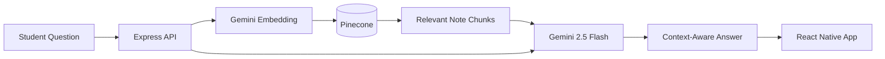
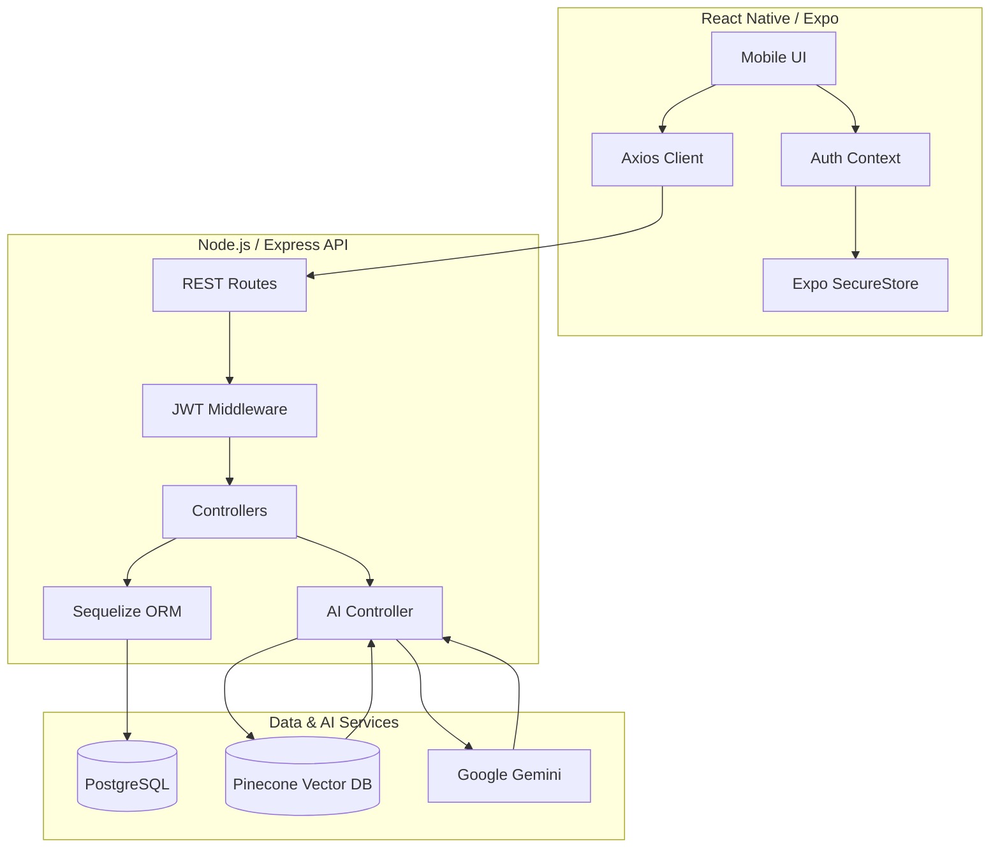
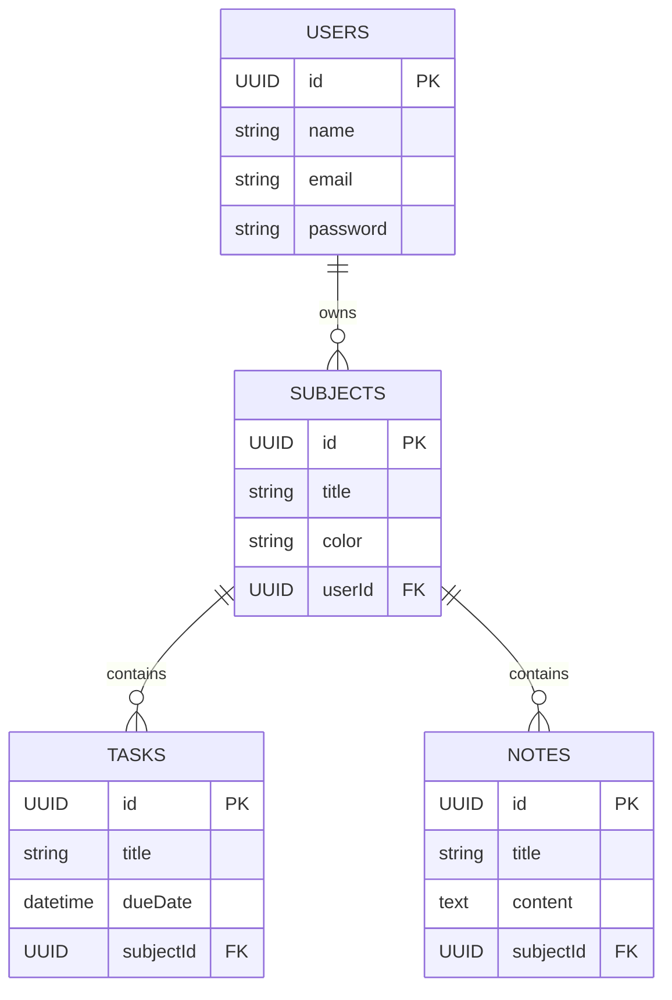
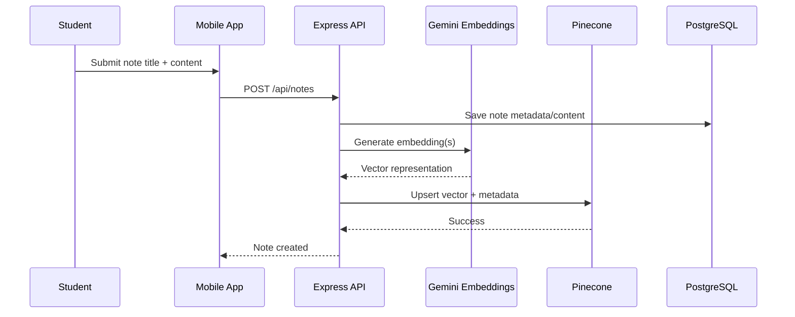
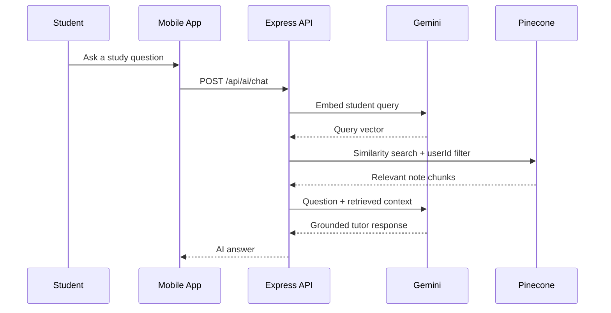
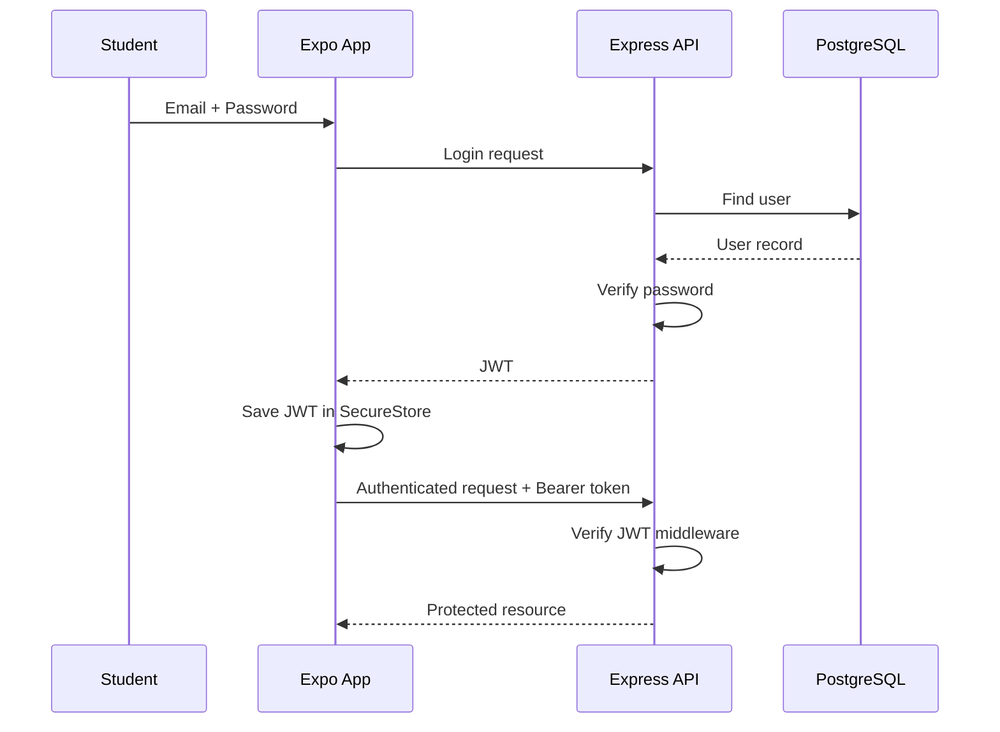

# 📚 StudyBuddy AI

### Your intelligent study companion — powered by Gemini AI + Pinecone RAG

**A full-stack, cross-platform student productivity app for organizing subjects, managing homework, uploading class notes, and learning with a context-aware AI tutor.**

<p>
  
  
  
  
  
</p>

<p>
  
  
  
  
</p>

> **Study smarter, not harder.** StudyBuddy AI connects your own class notes to an AI tutor using Retrieval-Augmented Generation, helping produce answers grounded in the material you actually study.

</div>

---

## ✨ Preview

<div align="center">
  
</div>

> [!TIP]
> Add your main application mockup or hero graphic at `assets/studybuddy-cover.png`. GitHub will render it automatically here.

### Mobile Screens

<div align="center">
  
  
  
  
</div>

---

## 🚀 About the Project

**StudyBuddy AI** is designed for middle and high school students who need one place to manage schoolwork and get intelligent help from their own learning materials.

Instead of using a generic chatbot alone, StudyBuddy AI combines **Gemini AI** with **Pinecone vector search**. Student notes are transformed into embeddings, stored as searchable vectors, retrieved when relevant, and supplied to Gemini as contextual academic material.

The result is a mobile study experience that combines **task management**, **subject organization**, **note storage**, **semantic retrieval**, and an **AI tutor** in one architecture.

---

## 🌟 Core Features

| Feature | Description |
| --- | --- |
| 🔐 **Secure Authentication** | Signup and login using JWT authentication, with tokens stored through Expo SecureStore. |
| 📊 **Smart Dashboard** | Quickly view subjects, upcoming tasks, study activity, and important actions. |
| 📚 **Subject Management** | Organize notes and homework by school subject. |
| ✅ **Homework & Tasks** | Create and retrieve study tasks with due dates and subject relationships. |
| 📝 **Smart Notes** | Upload class notes and associate them with a subject. |
| 🧠 **Gemini Embeddings** | Convert learning material into vector representations for semantic retrieval. |
| 🌲 **Pinecone RAG** | Retrieve the most relevant note chunks before asking Gemini to answer. |
| 💬 **AI Tutor** | Chat with Gemini 2.5 Flash using retrieved class material as context. |
| ⚡ **Function Calling** | Let the AI trigger supported actions such as creating homework tasks from natural-language instructions. |
| 👤 **User-Isolated Retrieval** | Pinecone queries use user metadata so retrieved study context belongs to the authenticated student. |

---

## 🧠 How the AI Tutor Works



The AI layer uses a **Retrieval-Augmented Generation (RAG)** workflow. Rather than relying only on the language model's general knowledge, the backend retrieves relevant portions of the student's uploaded notes and includes them in the generation context.

---

## 🏗️ System Architecture



---

## 🛠️ Technology Stack

### 📱 Frontend — Mobile Application

| Technology | Role |
| --- | --- |
| **React Native + Expo** | Cross-platform mobile application for Android and iOS. |
| **React Navigation** | Navigation between authentication and protected application screens. |
| **Expo SecureStore** | Encrypted storage for JWT authentication tokens. |
| **Axios** | API client with request interceptors for authenticated requests. |
| **React Context** | Global authentication state and session handling. |

### ⚙️ Backend — REST API & AI Engine

| Technology | Role |
| --- | --- |
| **Node.js + Express.js** | REST API and backend application layer. |
| **PostgreSQL** | Persistent relational storage for users, subjects, tasks, and note metadata. |
| **Sequelize ORM** | Models, associations, database access, migrations, and relational operations. |
| **JWT + bcrypt** | Authentication, authorization, and password protection. |
| **Pinecone** | Vector database used for similarity search over student note embeddings. |
| **Google Gen AI SDK** | Gemini chat generation, embeddings, academic guardrails, and function calling. |
| **Gemini 2.5 Flash** | Main conversational AI model for the tutor experience. |
| **Embedding Model** | Produces vector representations used by the RAG retrieval pipeline. |

---

## 🗃️ Database Model



### Relationship Summary

- One **User** can own many **Subjects**.
- One **Subject** can contain many **Tasks**.
- One **Subject** can contain many **Notes**.
- Vector records in Pinecone contain metadata that connects semantic chunks to the authenticated student and their study material.

---

## 🔄 RAG & Vector Workflow

### 1. Note Upload & Vectorization



The backend processes uploaded learning material and stores searchable vector representations in Pinecone with metadata such as:

```json
{
  "userId": "student-uuid",
  "subjectId": "subject-uuid",
  "title": "Photosynthesis Notes",
  "textChunk": "Plants convert light energy into chemical energy..."
}
```

### 2. Question, Retrieval & Generation



### 3. Gemini Function Calling

StudyBuddy AI can expose safe backend functions to Gemini. For example:

> **Student:** “Remind me to study History on Friday.”

Gemini can interpret the intent, extract the required task information, invoke the supported task-creation function, and let the backend persist the new task in PostgreSQL.

---

## 📂 Project Structure

```text
studybuddy-ai/
├── backend/
│   ├── src/
│   │   ├── config/
│   │   │   ├── database.js
│   │   │   └── pinecone.js
│   │   ├── controllers/
│   │   │   ├── aiController.js
│   │   │   ├── authController.js
│   │   │   ├── noteController.js
│   │   │   ├── subjectController.js
│   │   │   └── taskController.js
│   │   ├── middleware/
│   │   │   └── auth.js
│   │   ├── models/
│   │   │   ├── index.js
│   │   │   ├── Note.js
│   │   │   ├── Subject.js
│   │   │   ├── Task.js
│   │   │   └── User.js
│   │   ├── routes/
│   │   │   ├── aiRoutes.js
│   │   │   ├── authRoutes.js
│   │   │   ├── noteRoutes.js
│   │   │   ├── subjectRoutes.js
│   │   │   └── taskRoutes.js
│   │   └── server.js
│   ├── .env
│   └── package.json
│
├── studybuddy-mobile/
│   ├── src/
│   │   ├── api/
│   │   │   └── client.js
│   │   ├── context/
│   │   │   └── AuthContext.js
│   │   └── screens/
│   │       ├── HomeScreen.js
│   │       ├── LoginScreen.js
│   │       ├── RegisterScreen.js
│   │       ├── AIChatScreen.js
│   │       └── UploadNoteScreen.js
│   ├── App.js
│   └── package.json
│
├── assets/
│   ├── studybuddy-cover.png
│   ├── dashboard.png
│   ├── ai-chat.png
│   ├── upload-note.png
│   └── tasks.png
│
└── README.md
```

---

## ⚡ Getting Started

### Prerequisites

Before running StudyBuddy AI locally, install or prepare:

- **Node.js**
- **npm** or another Node package manager
- **PostgreSQL**
- **Expo Go** or an Android/iOS development environment
- A **Pinecone** project/index
- A **Google Gemini API key**

### 1. Clone the Repository

```bash
git clone https://github.com/YOUR_USERNAME/studybuddy-ai.git
cd studybuddy-ai
```

### 2. Install Backend Dependencies

```bash
cd backend
npm install
```

### 3. Configure Environment Variables

Create `backend/.env` and configure the values required by your implementation:

```env
PORT=5000

DB_HOST=localhost
DB_PORT=5432
DB_NAME=studybuddy_db
DB_USER=postgres
DB_PASSWORD=your_password

JWT_SECRET=replace_with_a_long_random_secret

GEMINI_API_KEY=your_gemini_api_key
PINECONE_API_KEY=your_pinecone_api_key
PINECONE_INDEX=studybuddy
```

> [!IMPORTANT]
> Never commit `.env`, database passwords, JWT secrets, Gemini API keys, or Pinecone credentials to Git.

### 4. Start the Backend

```bash
npm run dev
```

If your project uses a standard start script instead:

```bash
npm start
```

### 5. Install Mobile Dependencies

Open another terminal:

```bash
cd studybuddy-mobile
npm install
```

### 6. Configure the API Client

Point the Axios base URL in `src/api/client.js` to your backend development URL.

```js
const api = axios.create({
  baseURL: "http://YOUR_LOCAL_IP:5000/api",
});
```

> When testing on a physical phone, `localhost` usually refers to the phone itself. Use the development machine's reachable local network address or your chosen development tunnel.

### 7. Start the Expo App

```bash
npx expo start
```

Then open the app using Expo Go, an Android emulator, or an iOS simulator.

---

## 🔌 API Overview

The exact HTTP methods can be adjusted to match your route implementation, but the API is organized around these resource groups:

| Route Group | Purpose |
| --- | --- |
| `/api/auth` | Student registration, login, and authenticated user operations. |
| `/api/subjects` | Subject CRUD operations. |
| `/api/tasks` | Homework/task creation and retrieval. |
| `/api/notes` | Note storage, processing, and vectorization. |
| `/api/ai` | AI tutor chat, RAG retrieval, and supported Gemini tool/function workflows. |

### Authentication Flow



---

## 🔐 Security Design

StudyBuddy AI uses multiple layers of protection:

- Passwords should be hashed with **bcrypt** before storage.
- Authentication is performed using signed **JWTs**.
- Mobile tokens are stored with **Expo SecureStore** rather than plain AsyncStorage.
- Protected Express routes validate the token through authentication middleware.
- Pinecone retrieval is filtered by the authenticated student's `userId` to reduce cross-user context leakage.
- Secrets and provider API keys stay on the **backend** and should never be bundled into the mobile application.
- AI function calls should be validated server-side before database mutations are executed.

---

## 🧩 Example AI Request

```http
POST /api/ai/chat
Authorization: Bearer <JWT_TOKEN>
Content-Type: application/json
```

```json
{
  "message": "Explain photosynthesis using my biology notes."
}
```

Conceptually, the backend:

1. Authenticates the student.
2. Creates an embedding for the question.
3. Searches Pinecone using the student's metadata filter.
4. Selects relevant note chunks.
5. Builds a constrained academic prompt with the retrieved context.
6. Sends the context and question to Gemini.
7. Returns the generated answer to the mobile application.

---

## 🗺️ Roadmap

- [x] JWT authentication architecture
- [x] Subjects and tasks data model
- [x] Note upload architecture
- [x] Pinecone vector retrieval
- [x] Gemini-powered AI tutor
- [x] Gemini function-calling workflow
- [ ] Streaming AI responses
- [ ] Note chunking improvements and citation display
- [ ] PDF/document note import
- [ ] Push notifications for homework deadlines
- [ ] Study streaks and progress analytics
- [ ] Quiz generation from uploaded notes
- [ ] Flashcard generation
- [ ] Offline-first study experience
- [ ] Teacher/parent collaboration features

---

## 🖼️ Recommended `assets/` Images

For a premium GitHub presentation, add these images to the repository:

| File | Recommended Content |
| --- | --- |
| `assets/studybuddy-cover.png` | Wide hero mockup showing the StudyBuddy AI brand and multiple phone screens. |
| `assets/dashboard.png` | Dashboard/Home screen. |
| `assets/ai-chat.png` | Gemini AI Tutor conversation screen. |
| `assets/upload-note.png` | Note upload/vectorization interface. |
| `assets/tasks.png` | Homework/task management interface. |

Recommended export: **PNG**, sharp UI capture, consistent device frames, and a clean neutral or indigo-themed background.

---

## 🤝 Contributing

Contributions, ideas, and improvements are welcome. A typical contribution flow is:

```bash
git checkout -b feature/your-feature
git add .
git commit -m "feat: add your feature"
git push origin feature/your-feature
```

Then open a pull request describing the change and how it improves StudyBuddy AI.

---

## 📄 License

This project can be distributed under the **MIT License**. Add a `LICENSE` file to the repository if you want to publish it under MIT terms.

---

<div align="center">

## 🎓 StudyBuddy AI

**Organize. Learn. Ask. Improve.**

Built with **React Native**, **Node.js**, **PostgreSQL**, **Pinecone**, and **Gemini AI**.

⭐ If you find this project useful, consider starring the repository.

